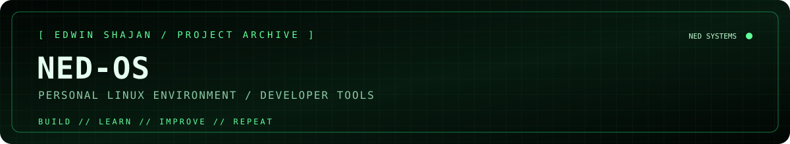
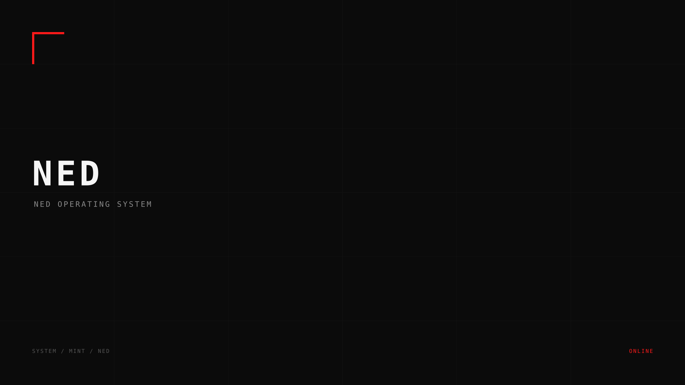

# NED-OS

<div align="center">



</div>

<div align="center">



### A personal Linux environment built around a terminal-first workflow

[](https://www.gnu.org/software/bash/)
[](https://kernel.org/)
[](https://github.com/Edwinshajan2006/Ned-OS)

</div>

NED-OS is a personal Linux customization and command-center project. It brings together shell utilities, system checks, network controls, desktop configuration and focus tools into one consistent environment.

> Build. Learn. Improve. Repeat.

## Features

- **NED command center** for accessing project utilities through one `ned` command.
- **System information and diagnostics** using Fastfetch and a project doctor script.
- **Network controls** for Wi-Fi and Bluetooth through NetworkManager and BlueZ tools.
- **Desktop utilities** for wallpaper and theme management.
- **Focus mode** with a configurable countdown and status command.
- **Desktop widgets and configuration** using Eww, Conky and project configuration files.
- **Shell-based workflow** designed to be inspected and customized.

## Command reference

| Command | Purpose |
|---|---|
| `ned help` | Show available commands |
| `ned info` | Display system information |
| `ned status` | Show system status |
| `ned doctor` | Run environment diagnostics |
| `ned wifi status` | Check Wi-Fi status |
| `ned bluetooth status` | Check Bluetooth status |
| `ned wallpaper` | Apply the configured wallpaper |
| `ned focus start 25` | Start a 25-minute focus session |
| `ned focus status` | Show remaining focus time |
| `ned focus stop` | Stop focus mode |

Available subcommands depend on the installed scripts and desktop utilities.

## Requirements

The project is intended for Linux. Some utilities are optional and are checked by `ned doctor`.

The current `install.sh` installer specifically checks for **APT and Debian/Ubuntu package management**. It is not a Fedora installer. On Fedora or another distribution, review the script and install the required dependencies using that distribution's package manager before adapting the setup.

Common tools used by the scripts include:

- Bash
- Fastfetch
- NetworkManager
- BlueZ / `bluetoothctl`
- xdotool
- Optional desktop tools such as Eww, Plank, XFCE utilities and Conky

## Installation

For a supported Debian/Ubuntu-based system:

```bash
git clone https://github.com/Edwinshajan2006/Ned-OS.git
cd Ned-OS
chmod +x install.sh
./install.sh
```

The installer uses `sudo apt` when dependencies are missing and installs the `ned` launcher into `~/.local/bin`.

After installation, open a new terminal if your PATH was updated, then run:

```bash
ned help
ned doctor
```

## Repository structure

```text
Ned-OS/
├── assets/       # Branding and wallpapers
├── config/       # Application configuration
├── conky/        # Conky configuration
├── eww/          # Eww widget definitions and styles
├── focus-guard/  # Browser focus-guard extension
├── scripts/      # NED command center and utilities
├── terminal-v2/  # Terminal-related project files
├── wallpapers/   # Wallpaper resources
└── install.sh    # Debian/Ubuntu-oriented installer
```

## Design direction

NED-OS uses a dark terminal-inspired visual language with restrained green accents. The aim is to make the desktop feel coherent while keeping the underlying scripts readable and practical.

## Roadmap

- [ ] Improve cross-distribution installation, including Fedora support
- [ ] Add safer dependency and desktop-environment detection
- [ ] Document each command and its supported environments
- [ ] Add screenshots of the current desktop and widgets
- [ ] Add automated checks for shell scripts

## Notes

NED-OS is a personal project and is actively evolving. Review scripts before running them, especially commands that change network, desktop or power settings.

---

<div align="center">

**NED-OS · BUILD // LEARN // IMPROVE // REPEAT**

</div>
